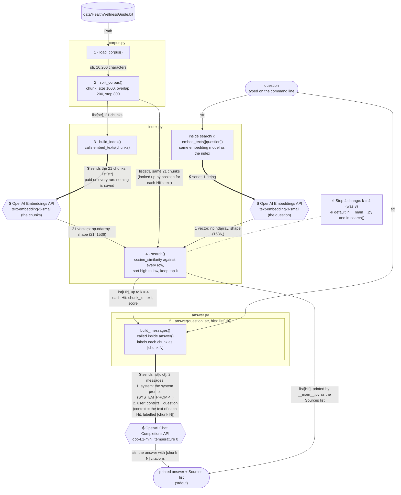

# Pipeline diagram

How one question flows through the app, one stage at a time. Each thin arrow is labelled with the Python type that travels along it. The thick 💲 arrows are paid OpenAI calls, and the arrow leaving each OpenAI box is what the call returns. (Strictly, the reply comes back to the function that made the call, which passes it on. The diagram skips that hop to keep it readable.) ⭐ marks where the Step 4 change (k raised from 3 to 4) sits.

## Reading the diagram

- **Two OpenAI endpoints, three paid calls per question.** The Embeddings API is drawn twice because it's called twice: once for all 21 chunks (because nothing is saved to disk, this happens again on every run) and once for the question. The Chat API is called once, for the answer.
- **The row-to-chunk link.** Row `i` of the `(21, 1536)` matrix belongs to chunk `i`. `search()` uses that position as the `chunk_id`, which is what makes every citation traceable.
- **Where the Step 4 change sits.** Raising `k` only moves the cut-off at the end of `search()`. The scores and their order don't change; one more `Hit` goes to the model.
- **Two arrows reach the output on purpose.** The `[chunk N]` citations inside the answer are written by the model and can be wrong. The Sources list is printed by `__main__.py` straight from the `list[Hit]` that `search()` returned, so it shows what the model was actually sent.
- **No hits, no chat call.** If `search()` returned nothing, `answer()` would return the `DECLINE` sentence without calling the chat model. With k = 4 that never happens on this corpus, so the diagram doesn't draw it.
